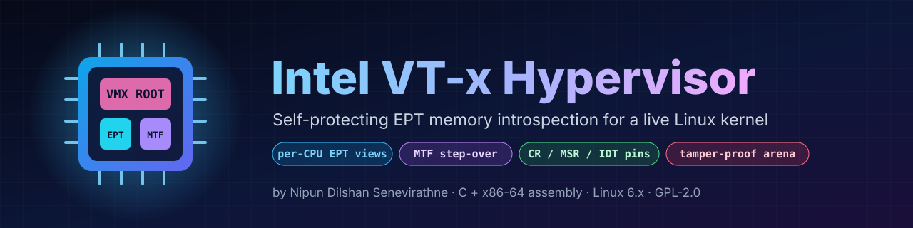
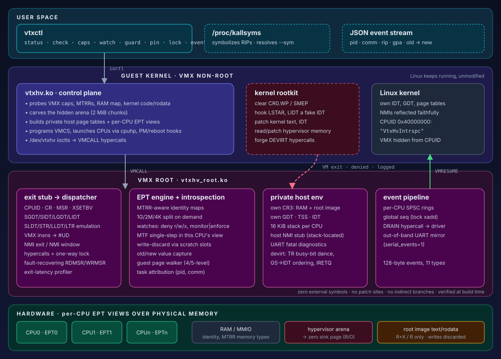
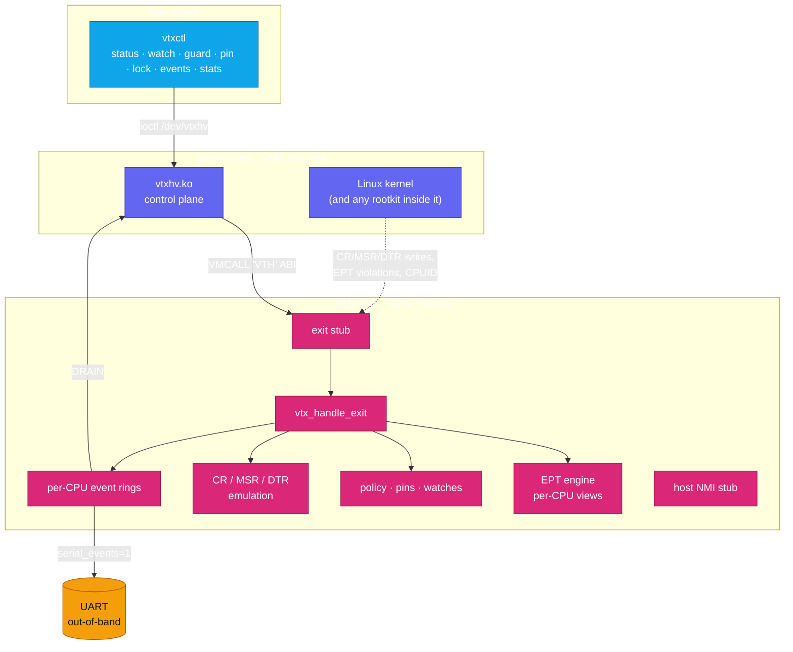
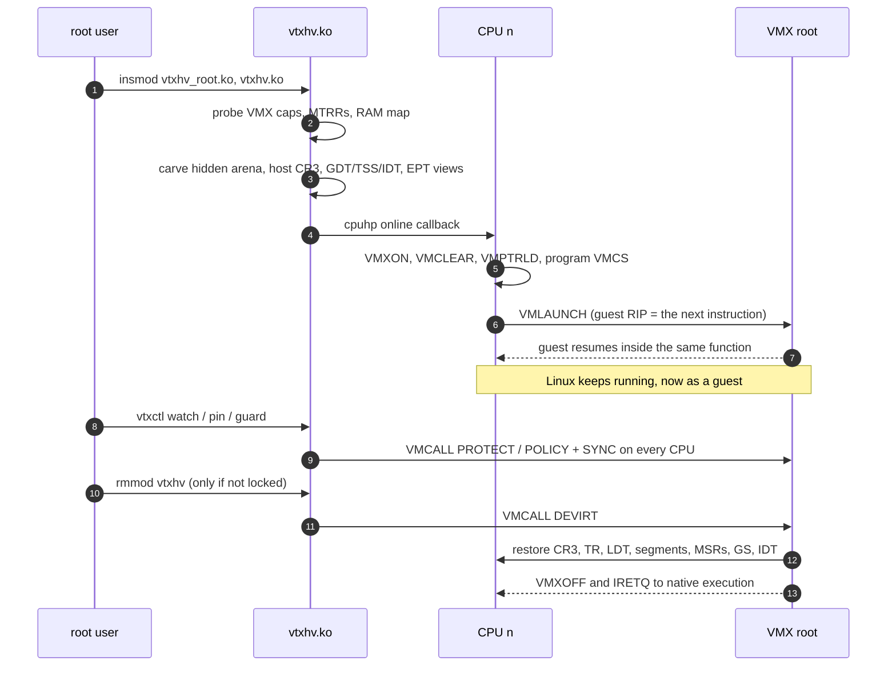
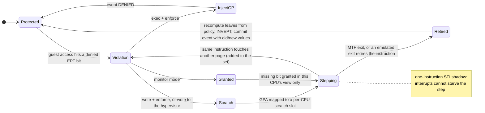
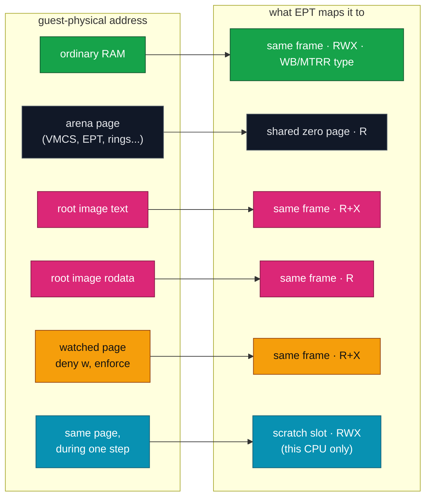
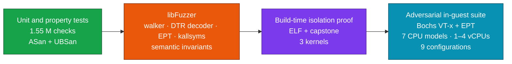

<p align="center">
  
</p>

<p align="center">
  
  
  
  
  
  
</p>

# Intel VT-x Hypervisor

**A self-protecting, late-launch hypervisor that slides underneath a running Linux kernel and turns Intel VT-x and EPT into a memory-introspection and kernel-integrity engine.**

You load two kernel modules. Every online CPU is moved into VMX non-root operation *in place*: the same kernel, the same processes, no reboot. From then on, about 25 KB of VMX-root code, sealed off from the kernel it watches, decides what that kernel may do to its own memory and control state:

- An **EPT watch** on any physical range (`r`, `w`, `x`, in monitor or enforce mode) reports every access with the RIP, CR3, GPA, GLA, pid, comm and the 8 bytes before and after the write.
- **Pins** on `CR0.WP`, `SMEP`, `SMAP`, `UMIP`, the syscall MSRs, `EFER`, `IDTR`, `GDTR` and `TR` stop the classic rootkit moves as they happen.
- The hypervisor's **own memory is invisible** to the guest. Its code is read-only from the guest's side, and a **one-way lock** closes every CPU-side path to unload, unpin or devirtualize it, even for an attacker with full ring-0 read/write. DMA needs the IOMMU; see [Limitations](#limitations).

> Written from the Intel SDM up: VMCS programming, EPT construction, the exit handlers, the NMI logic, the descriptor-table emulator, the guest page walker and the devirtualization path. It is not a wrapper around KVM, Xen or any hypervisor library.

---

## Contents

- [Highlights](#highlights)
- [Architecture](#architecture)
- [How a protected access is handled](#how-a-protected-access-is-handled)
- [What the guest sees](#what-the-guest-sees)
- [Quick start](#quick-start)
- [vtxctl](#vtxctl)
- [Module parameters](#module-parameters)
- [Hypercall ABI](#hypercall-abi)
- [Testing](#testing)
- [Hard problems this project solves](#hard-problems-this-project-solves)
- [Repository layout](#repository-layout)
- [Limitations](#limitations)
- [Roadmap](#roadmap)
- [Author and license](#author-and-license)

---

## Highlights

| | |
|---|---|
| 🧬 **Late launch under a live kernel** | Each CPU is virtualized from inside a `cpuhp` callback. `VMLAUNCH` "returns" into the same function as a guest, and devirtualization reverses it with an `IRETQ`, including a TSS busy-bit dance and an NMI-safe GS/IDT ordering. |
| 🛡️ **A root image that cannot be patched** | The VMX-root code is one translation unit, built in a separate module with no ftrace, no retpoline thunks, no CFI and no jump labels. A build-time ELF/disassembly checker proves it has zero external symbols, no writable data, no patch sites and no indirect branches. |
| 🫥 **Hidden arena** | VMCS, VMXON, EPT tables, rings, page tables, stacks and policy live in physically contiguous chunks that every EPT view maps to a read-only zero page. Guest writes are discarded and logged as `tamper`. |
| 🔬 **Per-CPU EPT views** | MTRR-aware 1G/2M/4K identity maps, split on demand. Watches are relaxed in *only the stepping CPU's* view for exactly one instruction (MTF), so another CPU cannot race through the window. |
| ✍️ **Old/new value capture** | Write events carry the 8 bytes before and after. Enforce-mode writes land in a per-CPU scratch slot, so you see what the attacker *tried* to write while memory stays intact. |
| 📌 **Architecturally exact pinning** | Emulated `MOV CR0/CR4` faults exactly where silicon faults, including `CR0.WP` vs `CR4.CET`, PCIDE and LA57. MSR writes check canonicality before the pin policy applies. |
| 🧭 **Descriptor-table emulator** | All eight of `SGDT SIDT SLDT STR LGDT LIDT LLDT LTR`, with full base/index/scale/segment decoding from the VM-exit instruction information, a 4/5-level guest page walker (SMEP, SMAP, `AC`, WP, A/D), atomic split-page stores and correct `#PF` reflection. |
| 🚫 **No confused deputy** | Every host write made on the guest's behalf (emulated stores, A/D bits, the `LTR` busy bit, hypercall output buffers) passes the same write policy as EPT. The hypervisor cannot be turned into a write gadget against itself or against guarded kernel pages. |
| ⚡ **NMIs done right** | NMI exiting, virtual NMIs, NMI-window and interrupt-window fallback under STI blocking, a host NMI stub that finds its vCPU from the stack, and IDT-vectoring re-injection. Exercised with SMP `sysrq-l` NMI backtraces. |
| 🔒 **One-way lock** | After `vtxctl lock --yes`: no `DEVIRT`, no unpin, no unwatch, no CPU offline, no suspend, no `rmmod`. Forged hypercalls from a rootkit return `-EPERM`. |
| 📡 **Out-of-band evidence** | Optional UART mirror of every event, written from VMX root, which a compromised guest cannot filter. |
| 🧪 **Tested like a product** | 1.55 M unit checks under ASan + UBSan, four libFuzzer harnesses with semantic oracles, and an adversarial in-guest test suite booted under emulated VT-x on seven Intel CPU models, from Sandy Bridge to Sapphire Rapids. |

---

## Architecture

<p align="center">
  
</p>



The two modules are two trust domains. `vtxhv.ko` runs as part of the guest: it probes the CPU, carves the arena, builds page tables and VMCSs, and translates ioctls into hypercalls. `vtxhv_root.ko` contains **all** code that runs in VMX root. The host executes nothing else, and it reads no guest-writable memory for control decisions.

### Lifecycle



---

## How a protected access is handled



A watch costs two VM exits per access. Linux never touches a watched page unless you asked to watch something it uses, so the steady-state cost of the hypervisor is close to zero. `CPUID` dominates the exit profile; see the `stats` sample below.

---

## What the guest sees



---

## Quick start

**Requirements:** an Intel CPU with VT-x and EPT (Nehalem or later; the matrix covers Sandy Bridge to Sapphire Rapids). VMX must be enabled in firmware and no other hypervisor active, so unload `kvm_intel` first. You also need Linux 6.x headers, GCC and Python 3 with `pyelftools` and `capstone` for the isolation check.

```bash
make                                   # vtxhv_root.ko, vtxhv.ko, vtxctl
make check                             # prove the VMX-root image is isolated
make test-unit                         # 1.55 M checks, ASan + UBSan

sudo rmmod kvm_intel 2>/dev/null
sudo insmod kmod/vtxhv_root.ko
sudo insmod kmod/vtxhv.ko serial=0x2f8 serial_events=1
sudo tools/vtxctl/vtxctl check         # every CPU answers CPUID 0x40000000 with "VtxHvIntrspc"
```

Protect a machine the way you would in production:

```bash
vtxctl pin all                         # CR0.WP, SMEP, SMAP, UMIP, syscall MSRs, EFER, IDTR, GDTR, TR
vtxctl guard text                      # monitor every write to kernel text
vtxctl guard rodata enforce            # refuse writes to kernel rodata
vtxctl guard idt enforce               # the IDT page becomes immutable
vtxctl watch add --sym modprobe_path --len 256 --deny w --name modprobe   # a classic LPE target
vtxctl lock --yes                      # one-way: no unload, unpin or unwatch until reboot
vtxctl events -f                       # live, symbolized event stream
```

> For the strongest guarantees, load from the initramfs with `lock=1`, before anything else gets a chance to run in ring 0.

---

## vtxctl

| Command | What it does |
|---|---|
| `status` | State, pins, watches, arena, EPT pool, root image, features (`--json`) |
| `check` | Ask every CPU for the CPUID hypervisor leaf and prove it is virtualized |
| `caps` | Decode all 23 VMX capability MSRs: controls, EPT/VPID, MISC, fixed bits |
| `watch add --phys/--virt/--sym ADDR [--len N] [--deny rwx] [--mode monitor\|enforce] [--name S]` | Arm an EPT watch. Virtual ranges are split into physical runs. |
| `watch list` / `watch del ID` | List with hit counts, or remove (refused when locked) |
| `guard text\|rodata\|idt [monitor\|enforce]` | One-word protection of kernel text, rodata or the IDT page |
| `pin LIST` / `unpin LIST` | `cr0.wp cr4.smep cr4.smap cr4.umip msr.syscall msr.sysenter msr.efer idtr gdtr tr all` |
| `lock --yes` | Engage the one-way policy lock |
| `events [-f] [-c N] [--no-sym]` | Drain or follow events, symbolized through `/proc/kallsyms` (`--json` for pipelines) |
| `stats` | Exit-reason histogram with average cycles per exit, per-CPU totals and step counters |

### Real output

This is the output of the adversarial suite's demo block under emulated VT-x (Haswell model, Linux 6.18). The attack module tries to clear `CR0.WP`, hook `LSTAR`, swap the IDT, write the hypervisor's arena and code, `SGDT` into the hypervisor's code page, and use the `WLIST` hypercall as a write primitive into it.

```text
$ vtxctl events
SEQ     CPU   TYPE       ACTION  TASK                   RIP                                DETAIL
#1      cpu0  cr0        DENIED  1/init                 run+0x83 [vtxattack]  cr0 0x80050033 -> 0x80040033 (WP 1->0)
#2      cpu0  msr-write  DENIED  1/init                 run+0x348 [vtxattack]  IA32_LSTAR(0xc0000082) 0xffffffff8c000080 -> 0xffffffffdeadbeef
#3      cpu0  msr-write  allowed 1/init                 run+0x385 [vtxattack]  IA32_LSTAR(0xc0000082) 0xffffffff8c000080 -> 0xffffffff8c000080
#4      cpu0  dtr        DENIED  1/init                 run+0x5f5 [vtxattack]  LIDT 0xfffffe0000000000 -> 0xffff96a8c06b9000 limit=0xfff
#5      cpu0  tamper     DENIED  1/init                 run+0x2cd [vtxattack]  target=hypervisor-memory gpa=0xa00000 gla=0xffffa87200009000 acc=-w- attempted=0x0000000000000041
#6      cpu0  tamper     DENIED  1/init                 run+0x2cd [vtxattack]  target=hypervisor-image gpa=0x800000 gla=0xffffa8720000b000 acc=-w- attempted=0x56415741fa1e0fcc
#7      cpu0  tamper     DENIED  1/init                 run+0x1293 [vtxattack]  target=hypervisor-image gpa=0x800200 gla=0xffffa87200015200 acc=-w- attempted=0xfe799da63000007f via-emulator
#8      cpu0  hypercall  DENIED  1/init                 run+0xf6c [vtxattack]  hypercall 0x565448000000000b refused: output buffer 0x800000 overlaps protected page 0x800000
```

```text
$ vtxctl status
 Intel VT-x Hypervisor  (VtxHvIntrspc, ABI 1)
  state              ACTIVE on 1/1 CPUs
  virtualized        cpu0
  policy lock        open
  pins               cr0.wp,cr4.smep,msr.syscall,idtr
  watches            1 active slot
  events             8 total, 0 dropped, 3 tamper attempts
  EPT pool           8/352 pages (2.3%)
  hypervisor arena   2048 KiB in 1 chunk @0xa00000 (hidden from guest)
  root image         7 code pages, 1 rodata page (write-protected)
  identity map       0 .. 0x100000000 (on-demand above), MAXPHYADDR 40, host paging 4-level
  features           ept-1g ept-2m vpid virtual-nmi dt-exiting unrestricted exec-only mtf invpcid rdtscp true-ctls pti ept-wb introspection uart
```

```text
$ vtxctl stats
VM-EXIT REASON                    COUNT    SHARE     AVG CYCLES
CPUID                              1654   98.57%            115  ████████████████████████
VMCALL                               10    0.60%           3949
CR_ACCESS                             1    0.06%           1193
MSR_WRITE                             2    0.12%           1194
MONITOR_TRAP_FLAG                     2    0.12%           1287
GDTR_IDTR                             7    0.42%           7352
EPT_VIOLATION                         2    0.12%           4679
TOTAL                              1678

NMIs reflected 0, MTF steps 2 (interrupt-shadowed 0, recycled 0), spurious EPT 0, hypercalls 11, injected 0, emulator writes denied 2, events 8 (dropped 0)
```

Cycle counts come from an emulator and say nothing about silicon latency. The shape of the profile is the useful part.

---

## Module parameters

| Parameter | Default | Meaning |
|---|---|---|
| `pin` | `0` | Initial pin mask (`VTX_PIN_*`, `0x3ff` = all). Load fails if a requested pin cannot be enforced. |
| `lock` | `0` | Engage the one-way lock right after launch |
| `guard_text`, `guard_rodata`, `guard_idt` | `0` | `1` = monitor, `2` = enforce, applied at load |
| `dtexit` | `1` | Intercept descriptor-table instructions. Required for `idtr`/`gdtr`/`tr` pins. |
| `introspect` | `1` | Attribute events to `pid`/`comm` by reading `current_task` through the guest GS base |
| `serial`, `serial_events` | `0x3f8`, `0` | UART port for fatal diagnostics, and whether to mirror every event to it. Use a port the guest does not drive. |
| `ring_events` | `1024` | Per-CPU event ring capacity |
| `pool_pages` | `256 + 96·ncpu` | EPT page pool for splits and on-demand mappings |

---

## Hypercall ABI

`VMCALL` with `RAX = 0x5654480000000000 | fn` (`"VTH"`), from CPL 0. A CPL-3 caller gets `#UD` and is logged.

| fn | Name | Notes |
|---|---|---|
| `0x01` | `PING` | Signature, version, lock state |
| `0x02` | `DEVIRT` | Return this CPU to native execution. Refused when locked. |
| `0x03` | `SYNC` | `INVEPT` and CR-policy refresh |
| `0x04` | `PROTECT` | Add a watch. Ranges touching hypervisor memory are rejected. |
| `0x05` | `UNPROTECT` | Refused when locked |
| `0x06` | `POLICY` | Set or clear pins. Clearing is refused when locked. |
| `0x07` | `LOCK` | Irreversible |
| `0x08`–`0x0b` | `DRAIN` `STATS` `QUERY` `WLIST` | Output buffers must be plain RAM. Any protected page gets `-EFAULT` and a logged event. |

---

## Testing

Testing has four layers, each with its own oracle. Full numbers are in **[docs/TESTING.md](docs/TESTING.md)**.



| Layer | What it proves |
|---|---|
| **Unit** (`make test-unit`) | The guest page walker matches an independent SDM reference across all **786,432** permission combinations (U/S, R/W, NX, WP, SMEP, SMAP, AC, implicit accesses, 4/5-level, 2M/1G pages). The descriptor-table decoder agrees with a reference across 276,480 encodings. MTRR type resolution matches brute force. EPT build/split/exhaustion and an SPSC ring hold under 2 M events across threads. The new write policy never lets a protected byte change. |
| **Fuzz** (`make test-fuzz`) | No crash, leak or UB. Oracles go beyond "does not crash": protected pages are byte-identical after any emulated access, split copies are exact, and EPT entries keep their software-valid bit. |
| **Isolation** (`make check`) | The VMX-root image has zero undefined symbols, no writable sections, no ftrace/alternatives/static-call/jump-label sites, no indirect branches, only code→code/rodata relocations, and every function is kprobe-blacklisted. Checked against Linux 6.18, Ubuntu 6.8 and Ubuntu 6.17 builds. |
| **Integration** (`make test-vm`) | An in-guest attacker module and user-space probes run 80–90 named tests per boot. They cover CR/MSR/DTR attacks pinned and unpinned, hypervisor tamper, confused-deputy attempts through `SGDT`, `LTR` and hypercall buffers, watches in every mode, page-straddling instructions, NMI reflection, CPU hot-unplug, five unload/reload cycles, and a full lock-down that a simulated rootkit then fails to undo. |

### Integration matrix (emulated VT-x, Linux 6.18)

| Configuration | Bochs CPU model | vCPUs | Guest paging | What it exercises | Tests | Result | Wall time |
|---|---|:-:|:-:|---|--:|:-:|--:|
| `corei7_sandy_bridge_2600k-1` | Sandy Bridge | 1 | 4-level | no SMEP/SMAP, no 1G EPT pages (2M/4K only), PTI | 83 | ✅ 83/83 | 52 s |
| `corei7_haswell_4770-1` | Haswell | 1 | 4-level | baseline, SMEP, 1G EPT pages, PTI | 83 | ✅ 83/83 | 52 s |
| `corei7_haswell_4770-2` | Haswell | 2 | 4-level | SMP: NMI reflection, CPU hot-unplug/replug | 88 | ✅ 88/88 | 70 s |
| `corei7_skylake_x-2` | Skylake-X | 2 | 4-level | SMAP | 88 | ✅ 88/88 | 121 s |
| `corei7_icelake_u-4` | Ice Lake | 4 | 4-level | UMIP, four virtualized CPUs | 88 | ✅ 88/88 | 140 s |
| `tigerlake-2` | Tiger Lake | 2 | 4-level | CET: kernel IBT, the `CR0.WP`/`CET` rule | 88 | ✅ 88/88 | 152 s |
| `sapphire_rapids-2` | Sapphire Rapids | 2 | **5-level** | LA57 host and guest walks, IBT | 88 | ✅ 88/88 | 201 s |
| `haswell-nodtexit` | Haswell | 2 | 4-level | `dtexit=0`: DTR pins must be refused, stores go through EPT | 88 | ✅ 88/88 | 71 s |
| `haswell-loadguards` | Haswell | 1 | 4-level | `pin=1023 guard_text=1 guard_rodata=1 guard_idt=2 serial_events=1` | 80 | ✅ 80/80 | 133 s |
| **Total** | 7 models | 1–4 | 4 + 5-level | | **774** | **✅ 774 / 0 failed** | |

Every boot also runs five complete unload/reload cycles and ends in lock-down, and it passes only if the guest kernel log contains no `BUG`, `WARNING`, `Oops` or call trace. The raw serial logs of these runs are in [`docs/results/`](docs/results/).

### Defects found and fixed

Each row was a real defect, found by the layer named, fixed, and pinned by a regression test:

| Found by | Defect |
|---|---|
| `fuzz_ept` | A fully-denied leaf for GPA 0 with UC memory type was all-zero, so it looked "not present" and could be remapped RWX. Every EPT entry now carries a software-valid bit. |
| Tiger Lake run (kernel IBT) | Clearing `CR0.WP` while `CR4.CET = 1` was emulated instead of raising #GP, so the next VM entry failed. The CR emulation now applies every architectural CR0/CR4 consistency rule. |
| `haswell-loadguards` run | An instruction straddling two exec-watched pages, combined with interrupts on every exit, starved the MTF step forever. Fixed with a one-instruction STI shadow for stepped entries, and an interrupt-window fallback for NMIs pending under STI blocking. |
| `haswell-nodtexit` run | Without descriptor-table exiting, `idtr`/`gdtr`/`tr` pins were silently dropped while the CLI reported success. They are now refused with `EOPNOTSUPP`. |
| Adversarial review → new tests | The host wrote guest memory on the guest's behalf without consulting policy: hypercall output buffers, `SGDT`/`SIDT` stores, A/D bits and the `LTR` busy bit could all target the hypervisor's own code. Now policy-checked and covered by 15 tests. |
| Adversarial review → new tests | A pinned MSR write skipped the architectural #GP for non-canonical values, and `SYSENTER_EIP/ESP` could reach the VMCS non-canonical, which a guest could use to make VM entry fail. |

---

## Hard problems this project solves

<details>
<summary><b>Launching under a running kernel without losing a single instruction</b></summary>

`vtx_asm_launch` saves the callee-saved registers and flags, writes `HOST_RSP`/`HOST_RIP` to point at the exit stub and `GUEST_RSP`/`GUEST_RIP` to a label just after `VMLAUNCH`, and launches. On success, the CPU "falls through" into the label as a guest, with every register the C caller expects intact. On failure, the instruction error comes back encoded in the return value, and the CPU was never left half-virtualized.
</details>

<details>
<summary><b>A host that the guest cannot reach, even with ring-0 read/write</b></summary>

The host has its own CR3 (RAM direct map, plus the root image mapped RX/R-NX), GDT, TSS, IDT with 32 exception stubs, and a 16 KiB stack per CPU. Exceptions in VMX root are fatal, except for three safe MSR/XSETBV helpers with a private fixup table. The root image is verified at build time to be self-contained, so there is nothing for the guest to hook: no PLT, no ftrace pad, no retpoline thunk, no static key.
</details>

<details>
<summary><b>Stepping one instruction through a watch without opening a race</b></summary>

Each CPU has its own EPT hierarchy. A step grants the missing permission, or remaps to a scratch slot, in the stepping CPU's view only. It opens an STI-equivalent interrupt shadow, single-steps with MTF, then recomputes the entry from the current policy (not from a saved copy) and `INVEPT`s. Instructions that touch several watched pages accumulate a step set of up to 16 pages. If an emulated exit retires the instruction, the step is closed at once.
</details>

<details>
<summary><b>Emulating descriptor-table instructions exactly</b></summary>

The decoder handles every operand form the VM-exit instruction-information field can express: base, index, scale, address size, segment, register or memory. RIP-relative operands arrive pre-resolved in the exit qualification. The decoder is checked exhaustively against a reference. Stores go through a guest page walker that enforces the same rules the CPU would, sets A/D bits, writes both halves of a split store or neither, and reflects `#PF` with the right error code and `CR2`. `LTR` sets the busy bit with a locked byte OR after a write-intent implicit-supervisor walk, as hardware does.
</details>

<details>
<summary><b>NMIs in every phase</b></summary>

An NMI can arrive while the guest runs (exit), while the host runs (host IDT), during the devirtualization sequence, or inside an STI shadow. Each case is handled. The host stub locates its vCPU from the stack, not from GS, so it is correct even while GS is being restored. The epilogue re-checks `nmi_pending` after writing the controls to close the lost-update window. Under STI blocking it uses the interrupt window, because the NMI window can open too early on some processors.
</details>

<details>
<summary><b>Devirtualizing back to bare metal</b></summary>

VM exit truncates the TR limit to `0x67`, so devirtualization clears the TSS busy bit through Linux's writable GDT alias, reloads TR, and switches back to the read-only fixmap GDT. It then restores LDT, segments, `FS.base`, the `SYSENTER` MSRs, `EFER`, `DR7`, `DEBUGCTL`, `CR0` and `CR4`, then GS, and only after that the IDT, so an NMI never sees a half-restored world. A single `IRETQ` lands the CPU back in the kernel.
</details>

---

## Repository layout

```text
include/uapi/vtxhv.h        kernel/user ABI: events, ioctls, pins, watches, stats
kmod/
  vtxhv_root.c              the VMX-root image: one translation unit, exports only entry points
  root_entry.inc            exit stub, host IDT and NMI stubs, safe MSR helpers, VMLAUNCH glue
  host.c                    exit dispatcher, CPUID/CR/MSR/XSETBV/DTR emulation, NMI logic, devirt
  host_mem.c                EPT violation handling, MTF step engine, on-demand mapping
  host_hc.c                 hypercalls, watch tables, the lock
  host_util.c               injection, skip, guest reads, task attribution, UART, fatal path
  ept.c  policy.c  mtrr.c   EPT construction and policy (pure code, shared with unit tests)
  walk.c  dtr.c  ring.c     guest page walker, DTR decoder, SPSC ring (pure, shared)
  main.c  setup.c  prep.c   control plane: probing, arena, host tables, VMCS, cpuhp, ioctls
  ctl.c                     VMX control negotiation against TRUE capability MSRs
tools/vtxctl/               the CLI: colour/JSON output, kallsyms symbolizer, caps decoder
scripts/                    isolation checker, Bochs and test-kernel builders
tests/unit/                 ASan/UBSan unit, property and concurrency tests
tests/fuzz/                 libFuzzer harnesses and regression inputs
tests/attack/               in-guest adversary module (/dev/vtxattack)
tests/vm/                   initramfs suite, user-space probes, Bochs runner, matrix
docs/                       ARCHITECTURE.md, THREAT-MODEL.md, TESTING.md, diagrams
```

About 4,800 lines of hypervisor C and assembly, 1,400 lines of CLI, and 3,100 lines of tests. None of it is generated.

---

## Limitations

The [threat model](docs/THREAT-MODEL.md) states every assumption and limitation. In short:

- **Validated under full-system emulation, not yet on silicon.** Bochs implements VMX, EPT and the SDM's VM-entry checks closely, across seven Intel models. Real hardware adds timing and errata. Test on your own machine, with a serial console, before you trust it.
- DMA is not mediated; enable the IOMMU. Load early and lock, because anything that ran before launch was not observed.
- Enforce mode on kernel text breaks run-time self-patching (static keys, ftrace, kprobes). Use monitor mode on general-purpose systems.
- Watches are page-granular, like EPT itself. A range is rounded out to whole 4 KiB pages, and every access to those pages is reported or enforced, including accesses to neighbouring variables. This is deliberate: filtering by byte range would need the exact access width of every instruction, and an attacker could use a wide store such as `FXSAVE` that starts outside the range to slip through.
- Intel VT-x only. No AMD SVM. No nested virtualization: guest `VMXON` gets `#UD`.

---

## Roadmap

- Validation on physical Intel hardware (client and server parts), with exit-latency numbers
- VT-d/IOMMU policy so that DMA cannot bypass the arena protection
- `#VE` (EPT-violation virtualization exception) and VMFUNC/EPTP switching for low-latency watches
- Per-watch rate limiting and sampling for hot pages
- A signed, measured launch path from the initramfs

---

## Author and license

**Nipun Dilshan Senevirathne**: design, implementation and test infrastructure.

Released under the **GNU General Public License v2.0** (see [LICENSE](LICENSE)), as required for Linux kernel modules.

> **Disclaimer.** Intel and VT-x are trademarks of Intel Corporation. This project is independent and is not affiliated with, sponsored by, or endorsed by Intel. It is a defensive research tool: run it only on systems you own or are explicitly authorized to test. A hypervisor runs below the operating system, and bugs at that level can hang or corrupt a machine. Use a test system first.
